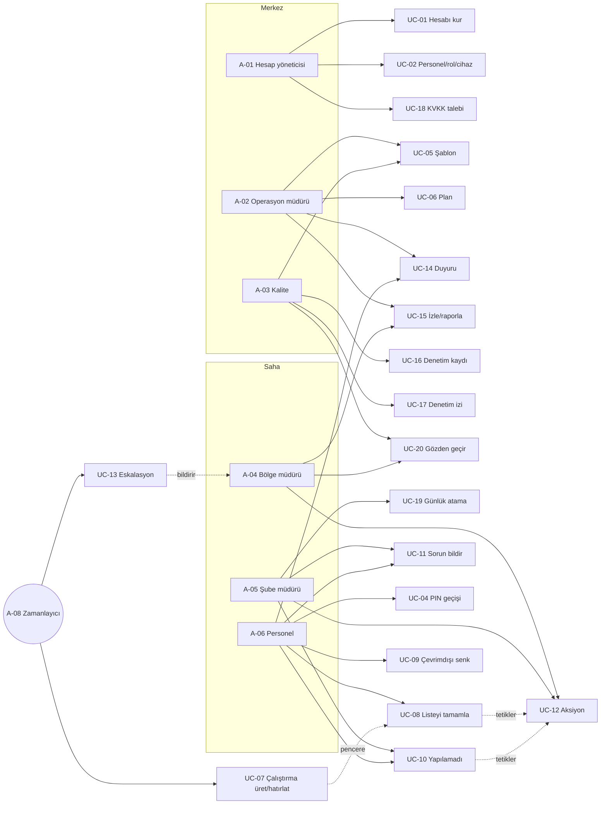

# Kullanım senaryosu (use case) kataloğu

Yirmi use case; her biri bir yeteneğe (CAP) ve birincil aktöre bağlı. Ayrıntılı akışlar 03-usecase-detaylari.md'de. Sürüm sütunu ADR-0008 v1 çekirdeğine göredir: **v1** ilk sürümde (içeriği 03-usecase-detaylari.md'deki "v1 notu" ile daraltılmış olabilir), **v1.1** pilot sonrası, **arka plan** = v1'de kullanıcı arayüzü yok, sistem/destek süreci var.

| UC | Ad | Birincil aktör | İkincil aktörler | CAP | Sürüm |
|---|---|---|---|---|---|
| UC-01 | Hesabı kur ve organizasyonu yükle | A-01 Hesap yöneticisi (v1: Yönetici) | A-14 e-posta | CAP-01, CAP-14 | v1 |
| UC-02 | Personel, rol ve cihazları yönet | A-01 | A-05 (kendi şubesi), A-11 SMS | CAP-01, CAP-02 | v1 |
| UC-03 | Oturum aç | A-06, A-05, A-04, A-02, A-01 | A-11 SMS (OTP) | CAP-02 | v1 |
| UC-04 | Ortak cihazda PIN ile geçiş yap | A-06 Personel | A-05 | CAP-02 | v1 |
| UC-05 | Şablon tasarla ve yayınla | A-02 Operasyon müdürü | A-03 | CAP-03, CAP-04, CAP-15 | v1 |
| UC-06 | Plan tanımla (tekrar, pencere, atama, eskalasyon) | A-02 | A-04 (bölgesi) | CAP-05, CAP-16 | v1 |
| UC-07 | Çalıştırmaları üret ve hatırlat | A-08 Zamanlayıcı | A-10 push, A-11 SMS | CAP-05, CAP-10 | v1 |
| UC-08 | Listeyi tamamla ve kanıt yükle | A-06 Personel | A-13 depolama | CAP-06, CAP-04 | v1 |
| UC-09 | Çevrimdışı tamamla ve senkronize et | A-06 | A-08 | CAP-07 | v1 |
| UC-10 | Yapılamadı bildir | A-06 | A-05 | CAP-08, CAP-09 | v1 |
| UC-11 | Sorun bildir | A-06, A-05 | A-04 | CAP-08, CAP-09 | v1 |
| UC-12 | Aksiyonu yönet ve kapat | A-05, A-04 | A-06 (kanıt), A-02 | CAP-09 | v1 |
| UC-13 | Eskalasyonu yürüt | A-08 Zamanlayıcı | A-05 → A-04 → A-02; A-10, A-11 | CAP-09, CAP-10 | v1 |
| UC-14 | Duyuru yayınla ve onay topla | A-02 | A-06, A-05 (onaylayan) | CAP-11, CAP-17 | v1.1 |
| UC-15 | Operasyonu izle ve raporla | A-02, A-04, A-03 | A-07 (salt okunur) | CAP-12, CAP-18 | v1 |
| UC-16 | Denetim kaydını ve kanıtı dışa aktar | A-03, A-02 | A-13, A-14 | CAP-12 | v1 |
| UC-17 | Denetim izini görüntüle ve doğrula | A-03, A-01 | A-12 | CAP-13 | arka plan |
| UC-18 | KVKK talebini işle (dışa aktar / sil / maskele) | A-01 | A-08 (saklama) | CAP-13 | süreç |
| UC-19 | Günün listelerini ata (yeniden atama) | A-05 Şube müdürü | A-06 | CAP-05 | v1 |
| UC-20 | Çalıştırmayı gözden geçir ve onayla | A-04, A-03 | A-05 | CAP-17 | v1.1 |

## Use case diyagramı (özet)

## Use case → ekran → test izlenebilirliği

| UC | Mobil ekranlar | Web ekranlar | Kabul testleri |
|---|---|---|---|
| UC-01 | – | SCR-W-01, SCR-W-02 | TC-001…TC-004 |
| UC-02 | – | SCR-W-02, SCR-W-03 | TC-005…TC-008 |
| UC-03 | SCR-M-01 | SCR-W-00 | TC-009…TC-012 |
| UC-04 | SCR-M-02 | – | TC-013…TC-016 |
| UC-05 | – | SCR-W-04, SCR-W-05 | TC-017…TC-024 |
| UC-06 | – | SCR-W-06 | TC-025…TC-032 |
| UC-07 | (bildirim) | – | TC-033…TC-038 |
| UC-08 | SCR-M-03, SCR-M-04, SCR-M-05 | – | TC-039…TC-050 |
| UC-09 | SCR-M-04 | – | TC-051…TC-056 |
| UC-10 | SCR-M-06 | – | TC-057…TC-061 |
| UC-11 | SCR-M-07 | – | TC-062…TC-064 |
| UC-12 | SCR-M-08 | SCR-W-09 | TC-065…TC-072 |
| UC-13 | (bildirim) | SCR-W-09 | TC-073…TC-078 |
| UC-14 | SCR-M-09 | SCR-W-10 | TC-079…TC-084 |
| UC-15 | SCR-M-10 | SCR-W-07, SCR-W-08, SCR-W-11 | TC-085…TC-094 |
| UC-16 | – | SCR-W-08, SCR-W-11 | TC-095…TC-099 |
| UC-17 | – | SCR-W-12 | TC-100…TC-103 |
| UC-18 | – | SCR-W-13 | TC-104…TC-107 |
| UC-19 | SCR-M-10 | SCR-W-07 | TC-108…TC-110 |
| UC-20 | SCR-M-10 | SCR-W-08 | TC-111…TC-112 |
