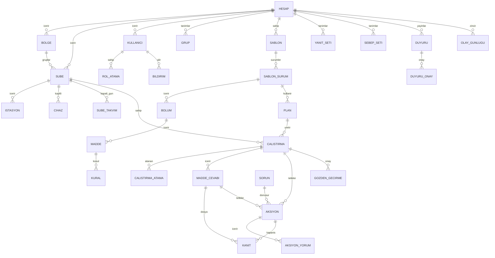

# Veri modeli

Mantıksal model; fiziksel şema (PostgreSQL) geliştirme deposunda göç dosyalarıyla tutulur. Tüm tablolar `hesap_id` taşır (kiracı yalıtımı, satır düzeyi güvenlik). Zamanlar UTC; gösterim şube saat diliminde. Kimlikler UUID (istemci üretimli olanlar idempotent yükleme için).

## Varlık-ilişki diyagramı

## Varlıklar ve temel alanlar

| Varlık | Temel alanlar | Notlar |
|---|---|---|
| HESAP | id, ad, marka (logo, renk), saat_dilimi_varsayilan, ayarlar (JSON: tolerans, eşik, vadeler, sessiz saatler, saklama_ay, kilit_dk…), durum, olusturma | Ayarlar 03-is-kurallari parametre tablosu |
| BOLGE | id, hesap_id, ad, kod | İsteğe bağlı seviye |
| SUBE | id, hesap_id, bolge_id?, kod (hesapta benzersiz), ad, adres, enlem, boylam, saat_dilimi, calisma_saatleri (JSON: gün → açılış/kapanış), sube_turu, durum | FR-0103 |
| ISTASYON | id, sube_id, ad, tur, qr_kodu | FR-0104 |
| CIHAZ | id, sube_id, ad, model, platform, push_token?, kiosk (bool), son_gorulme, durum | FR-0207; kişisel cihazlar da kayıt (kiosk=false) |
| SUBE_TAKVIM | sube_id, tarih, tur (kapalı/yarım), kaynak (hesap/şube) | BR-17 |
| KULLANICI | id, hesap_id, ad, telefon (E.164), eposta?, pin_hash?, sifre_hash?, totp_gizli?, dil, durum (aktif/pasif/maskeli), aydinlatma_onay (sürüm, zaman), konum_izni, olusturma | FR-0107, FR-1307 |
| ROL_ATAMA | kullanici_id, rol (enum), kapsam_turu (hesap/bölge/şube), kapsam_id | FR-0205 |
| GRUP | id, hesap_id, ad, kural (JSON: rol/bölge/şube/istasyon/şube_türü) | FR-0206, dinamik |
| SABLON | id, hesap_id, ad, kategori, kutuphane_kaynak_id?, durum | |
| SABLON_SURUM | id, sablon_id, surum_no, durum (taslak/yayında/arşiv), ayarlar (yalnızca_kamera, tolerans_varsayilan, sebep_seti_id, esik, gozden_gecirme), yayin_zamani, olusturan | FR-0301 |
| BOLUM | id, sablon_surum_id, sira, baslik | |
| MADDE | id, bolum_id, sira, tur (enum), baslik, ipucu, zorunlu, kanit_zorunlu, agirlik, kritik, yapilamadi_izinli, istasyon_turu?, secenekler (JSON), birim, min, maks, medya (talimat için) | FR-0303, FR-0304 |
| KURAL | id, madde_id, kosul (JSON: op, değer), eylemler (JSON dizi: tür + parametre) | FR-0401 |
| YANIT_SETI | id, hesap_id, ad, secenekler (JSON: etiket, geçer/geçmez) | |
| SEBEP_SETI | id, hesap_id, ad, sebepler (JSON) | FR-0802 |
| PLAN | id, hesap_id, sablon_surum_id, ad, kapsam (JSON: şube/grup listesi), rrule, pencere_baslangic, pencere_bitis, tolerans_dk, calisma_saatinden (JSON), atama (JSON: tür, hedef, kural biri/herkes), hatirlatma (JSON), eskalasyon (JSON adımlar), tek_seferlik (bool), durum | FR-0501 |
| CALISTIRMA | id, plan_id, sablon_surum_id, sube_id, is_gunu (date), pencere_baslangic, pencere_bitis, tolerans_bitis, durum (enum), puan?, basarili?, gonderim_zamani?, yapilmayacak_sebep?, olusturma | Benzersiz (plan_id, sube_id, pencere_baslangic) |
| CALISTIRMA_ATAMA | calistirma_id, kullanici_id?, rol?, istasyon_id?, tamamladi (bool), gonderim_zamani? | BR-16 |
| MADDE_CEVABI | id (istemci UUID), calistirma_id, madde_id, kullanici_id, cihaz_id, deger (JSON), durum (geçti/geçmedi/yapılamadı/atlandı), yapilamadi_sebep?, not?, cihaz_zamani, sunucu_zamani, zaman_farki_sn, enlem?, boylam?, uzaklik_m?, bayraklar (JSON: galeri, uzak, konum_yok, saat_farki, gec_senk), ek_kayit_mi, onceki_cevap_id? | BR-12, BR-13, BR-15 |
| KANIT | id (istemci UUID), cevap_id?, aksiyon_id?, tur (foto/video), ham_nesne_anahtari, damgali_nesne_anahtari, sha256, boyut, genislik, yukseklik, cekim_zamani, sunucu_zamani, silindi_mi (saklama/KVKK), silme_zamani? | ADR-0004 |
| SORUN | id, sube_id, istasyon_id?, bildiren_id, kategori, not, durum, olusturma | FR-0806 |
| AKSIYON | id, hesap_id, sube_id, istasyon_id?, kaynak_turu (madde/sorun/elle/kaçırma), kaynak_id, baslik, aciklama, atanan_id, olusturan_id, oncelik, vade, durum, kapanis_notu?, kapanis_zamani?, onaylayan_id?, etiketler | FR-0901 |
| AKSIYON_YORUM | id, aksiyon_id, yazan_id, metin, kanit_id?, zaman | FR-0906 |
| ESKALASYON_ADIMI | id, kaynak_turu (çalıştırma/aksiyon), kaynak_id, adim_no, alici_rol/kullanici, planlanan_zaman, gonderim_zamani?, durum | FR-0912 |
| DUYURU | id, hesap_id, baslik, icerik, ekler, hedef (JSON), yayin_zamani, onay_gerekli, imza_gerekli, sablon_surum_id?, olusturan | FR-1101 |
| DUYURU_ONAY | duyuru_id, kullanici_id, onay_zamani?, imza_kanit_id?, hatirlatma_sayisi | FR-1103 |
| BILDIRIM | id, kullanici_id, kanal, olay_turu, kaynak, icerik, gonderim, teslim?, okunma?, hata_kodu? | FR-1005 |
| OLAY_GUNLUGU | id (sıralı), hesap_id, zaman, aktor_id?, aktor_tur (kullanıcı/sistem), olay_turu, nesne_turu, nesne_id, ozet (JSON önce/sonra), ip, cihaz_id?, onceki_hash, hash | Ekle-yalnız; FR-1301 |
| GUNLUK_KOK | tarih, hesap_id, kok_hash, rfc3161_damga, damga_zamani | FR-1302 |
| GOZDEN_GECIRME | calistirma_id, gozden_geciren_id, not, imza_kanit_id?, zaman | FR-1701 (Should) |
| KVKK_TALEP | id, hesap_id, kullanici_id, tur (dışa aktar/sil), talep_zamani, tamamlanma?, sonuc | FR-1309 |

## Sabitler (enum)

- `rol`: hesap_yoneticisi, operasyon_muduru, kalite, bolge_muduru, sube_muduru, personel, gozlemci
- `madde.tur`: onay, secim, sayi, sicaklik, metin, foto, video, imza, barkod, tarih_saat, talimat
- `calistirma.durum`: planlandi, acik, devam, tamamlandi, gec_tamamlandi, kacirildi, yapilmayacak (+ `basarili` bayrağı ayrı)
- `cevap.durum`: gecti, gecmedi, yapilamadi, atlandi
- `aksiyon.oncelik`: dusuk, orta, yuksek, kritik · `aksiyon.durum`: acik, devam, kapatma_bekliyor, kapali, reddedildi
- `bildirim.kanal`: push, sms, eposta (whatsapp v1.x)

## Bütünlük ve indeks notları

- Kiracı yalıtımı: her sorgu `hesap_id` ile; PostgreSQL satır düzeyi güvenlik politikası oturum değişkeniyle.
- Benzersizlikler: SUBE(hesap_id, kod); CALISTIRMA(plan_id, sube_id, pencere_baslangic); KULLANICI(hesap_id, telefon).
- Sık sorgular için indeks: CALISTIRMA(sube_id, is_gunu), CALISTIRMA(durum, tolerans_bitis) (zamanlayıcı), AKSIYON(atanan_id, durum, vade), MADDE_CEVABI(calistirma_id), OLAY_GUNLUGU(hesap_id, zaman), KANIT(cevap_id).
- Silme yok: kullanıcı, çalıştırma, cevap, kanıt satırları silinmez (durum/maskeleme); yalnızca nesne depodaki dosya saklama/KVKK ile silinir ve KANIT.silindi_mi işaretlenir.
- Büyük tablolar (MADDE_CEVABI, OLAY_GUNLUGU) aylık bölümlenir (partition) — 2 yılda ~100 M satır varsayımı.
