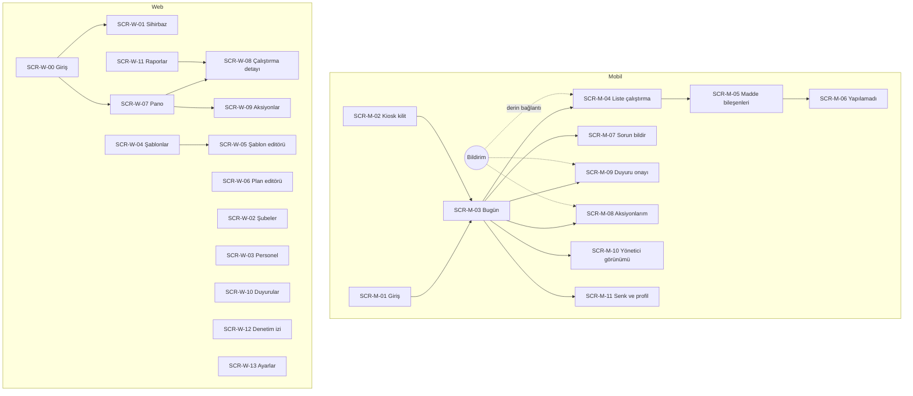

# Ekran envanteri ve navigasyon

Tel-çerçeveler: [Mobil ekranlar](02-mobil-ekranlar.html) · [Web ekranlar](03-web-ekranlar.html) (tarayıcıda açılır; her çerçevede numaralı açıklamalar FR'lere bağlanır). Görsel dil: [Tasarım sistemi](04-tasarim-sistemi.md). Bu belge ekranların kimliğini, amacını, giriş noktalarını ve durumlarını tanımlar; yüksek doğruluklu tasarım (F8) bu envanteri değiştirmez, giydirir. **Sürüm** sütunu ADR-0008 v1 çekirdeğine göredir: v1'de 10 mobil + 12 web ekran (bazıları sadeleştirilmiş), 3 ekran v1.1.

## Mobil (Flutter — personel ve yönetici görünümü)

| SCR | Ekran | Amaç | Giriş noktası | Durumlar | FR | Sürüm |
|---|---|---|---|---|---|---|
| SCR-M-01 | Giriş | Telefon + OTP; ilk girişte aydınlatma ve konum izni | Uygulama açılışı (oturum yoksa) | OTP bekleniyor, hatalı kod, blok, aydınlatma sürüm değişti | FR-0201, 0204, 1307, 1308 | v1 |
| SCR-M-02 | Kiosk kilit | Şube personel listesi, PIN girişi, kullanıcı değiştirme | Kiosk cihazda her zaman (kilit) | Blok (1 dk), PIN sıfırlama, cihaz kaydı yok | FR-0207…0210 | v1 |
| SCR-M-03 | Bugün | Bugünkü çalıştırmalar, durum ve geri sayım; onay bekleyen duyuru şeridi; "Sorun bildir" | Girişten sonra ana ekran | Boş gün, kapalı gün, çevrimdışı, bekleyen senk | FR-0601, 0610, 1103, 0806 | v1 (duyuru şeridi yok) |
| SCR-M-04 | Liste çalıştırma | Bölümler ve maddeler, ilerleme, gönder | Bugün → çalıştırma; bildirim derin bağlantısı; QR | Devam ediyor, pencere kapandı (geç), tolerans bitti (kilitli), herkes tamamlasın (bölümler), çevrimdışı rozeti | FR-0602…0610 | v1 (tek kullanıcı, ek kayıt yok) |
| SCR-M-05 | Madde bileşenleri | Onay, seçim, sayı/sıcaklık, metin, kamera, video, imza, barkod, tarih-saat, talimat | SCR-M-04 içinde | Aralık dışı uyarısı, koşullu ek soru, fotoğraf zorunlu, kamera izni yok | FR-0303, 0305, 0402, 0604 | v1 (6 tür) |
| SCR-M-06 | Yapılamadı | Sebep seti, not, fotoğraf | Madde → "Yapılamadı" | Diğer→not zorunlu; kritik maddede yok | FR-0801…0804 | v1 |
| SCR-M-07 | Sorun bildir | Kategori, istasyon, fotoğraf, not | Bugün → "Sorun bildir" | Gönderildi onayı | FR-0806…0809 | v1 (sabit kategori) |
| SCR-M-08 | Aksiyonlarım | Liste (filtreler) + aksiyon detayı: geçiş, kapanış kanıtı, yorum | Sekme; bildirim derin bağlantısı | Gecikmiş, kritik, kapatma bekliyor, reddedildi | FR-0901…0910 | v1 (açık/kapalı, not) |
| SCR-M-09 | Duyuru | Metin/ek, "Okudum ve anladım", imza (Should) | Bugün şeridi; bildirim | Onaylandı, imza gerekli | FR-1101…1106 | v1.1 |
| SCR-M-10 | Yönetici görünümü | Şube/bölge özet ızgarası, günlük atama, kanıt inceleme, gözden geçirme (Should) | Rol: şube/bölge müdürü — sekme | Bölge seçici, atama düzenleme | FR-1211, 0519, 0520, 1701 | v1 (Bölgem listesi + günlük atama) |
| SCR-M-11 | Senk ve profil | Bekleyen kayıt/kanıt, son senk, hata ayrıntısı; profil, PIN değiştir, bildirim tercihleri, çıkış | Menü | Senk hatası, kuyruk dolu | FR-0708, 1003 | v1 |

Mobil sekmeler: **Bugün · Aksiyonlar · (Yönetici: Şubem/Bölgem) · Menü**. Kiosk cihazda Menü'de yalnızca "Kullanıcı değiştir" ve "Senk".

## Web (React — yönetim paneli)

| SCR | Ekran | Amaç | Ana bileşenler | FR | Sürüm |
|---|---|---|---|---|---|
| SCR-W-00 | Giriş | E-posta + şifre, 2FA, şifre sıfırlama | Form, TOTP | FR-0202, 0203 | v1 (2FA yok) |
| SCR-W-01 | Kurulum sihirbazı | Marka → şubeler → şablon → plan → personel → yayın | Adım çubuğu, Excel yükleme ve hata raporu, özet | FR-1401, 0105, 0106 | v1 (4 adım, tek plan) |
| SCR-W-02 | Şubeler | Hiyerarşi ağacı, şube kartı (meta, saatler, takvim), istasyonlar ve QR, cihazlar | Ağaç + detay paneli, içe aktar | FR-0102…0106, 0207, 0515 | v1 |
| SCR-W-03 | Personel ve roller | Liste, filtre, rol/kapsam düzenleme, davet, pasifleştir/maskele, akıllı gruplar | Tablo, yan panel, grup kural editörü | FR-0107…0110, 0205, 0206 | v1 (4 rol, grup yok) |
| SCR-W-04 | Şablonlar | Liste (sürüm, yayın durumu, kullanan planlar), kütüphane sekmesi | Tablo, kütüphane kartları | FR-0301, 0310, 0311 | v1 (8 şablon) |
| SCR-W-05 | Şablon editörü | Bölüm/madde ağacı, madde ayar paneli, koşul editörü, puan/eşik, şablon ayarları, mobil önizleme, yayın doğrulaması | Üç sütun: yapı · ayar · önizleme | FR-0302…0309, 0312, 0401…0404 | v1 (basit editör, sabit kural) |
| SCR-W-06 | Plan editörü | Şablon sürümü, kapsam ağacı, tekrar ve pencere, atama, hatırlatma, eskalasyon merdiveni, 7 gün önizleme | Form + takvim önizleme | FR-0501…0512, 0517 | v1 (sabit hatırlatma/eskalasyon) |
| SCR-W-07 | Operasyon panosu | Gün seçici, şube × liste ızgarası, filtreler, hücre durumu, canlı yenileme; günlük atama düzenleme | Izgara, durum lejantı | FR-1201, 0519 | v1 (istisna odaklı) |
| SCR-W-08 | Çalıştırma detayı | Maddeler ve cevaplar, kanıt küçük resim/tam boy ve damga, puan, aksiyonlar, olay izi, ek kayıt, PDF, gözden geçirme (Should) | İki sütun + galeri | FR-1202, 1213, 0608, 1701 | v1 (gözden geçirme yok) |
| SCR-W-09 | Aksiyonlar | Liste/filtre (bana, şube, bölge, gecikmiş, kritik), aksiyon detayı, geçişler, yorumlar, eskalasyon adımları | Tablo + yan panel | FR-0901…0915 | v1 (açık/kapalı) |
| SCR-W-10 | Duyurular | Oluştur (hedef, ek, onay/imza), onay raporu, hatırlat | Form + rapor | FR-1101…1106 | v1.1 |
| SCR-W-11 | Raporlar | Tamamlanma/zamanındalık, şube sıralaması, başarısız madde ısı haritası, yapılamadı sebepleri, ölçüm günlüğü, kanıt galerisi, aksiyon raporu, kişi düzeyi takip; dışa aktarım (PDF/Excel/paylaşım) | Sekmeler, filtre çubuğu, grafikler, tablo | FR-1203…1218 | v1 (aylık özet, sıcaklık günlüğü, galeri) |
| SCR-W-12 | Denetim izi | Olay listesi (filtre), okunabilir olay metni, zincir doğrulama, günlük kök ve RFC 3161 | Tablo + doğrulama paneli | FR-1301…1304 | v1.1 |
| SCR-W-13 | Ayarlar | Hesap, marka, bildirim varsayılanları, eskalasyon şablonları, sebep/kategori setleri, tatil takvimi, saklama, KVKK talepleri, aydınlatma metni, faturalama sayacı, API/webhook (Should) | Sekmeli ayar sayfaları | FR-1402, 1403, 1307, 1309…1312 | v1 minimal (hesap, tatil takvimi, aydınlatma, şube sayacı) |

Tel-çerçevesi çizilmeyen web ekranları: SCR-W-00 (standart giriş formu + TOTP), SCR-W-04 (tablo + kütüphane kartları), SCR-W-10 (duyuru formu + onay raporu tablosu) — envanterdeki bileşen tanımı geliştirme için yeterli; hi-fi aşamasında (F8) çizilir.

Web ana gezinme (sol menü): **Pano · Şubeler · Personel · Şablonlar · Planlar · Aksiyonlar · Duyurular · Raporlar · Denetim izi · Ayarlar**. Rol kapsamı menüyü daraltır (bölge müdürü: Pano, Aksiyonlar, Duyurular, Raporlar).

## Navigasyon haritası

## Ekran durumları (ortak)

Her ekran için tasarımda dört durum zorunlu: **yükleniyor**, **boş** (açıklayıcı metin + ilk eylem), **hata** (ne oldu, ne yapmalı), **çevrimdışı** (mobil: veri önbellekten, yazma kuyruğa). Liste ekranlarında ek olarak "filtre sonucu boş".

## Erişilebilirlik ve ergonomi (mobil)

- Dokunma hedefi ≥ 44 px; ana eylem alt kenarda (başparmak); geri ve iptal her zaman sol üstte.
- Madde bileşenleri tek elle; sayısal girişte büyük tuş takımı; sıcaklıkta ± adım düğmeleri.
- İkon + kısa etiket; renk tek başına anlam taşımaz (durumlar ikonla da ayrışır).
- Kiosk: yatay tablet düzeni; büyük personel avatarları; PIN tuş takımı.
