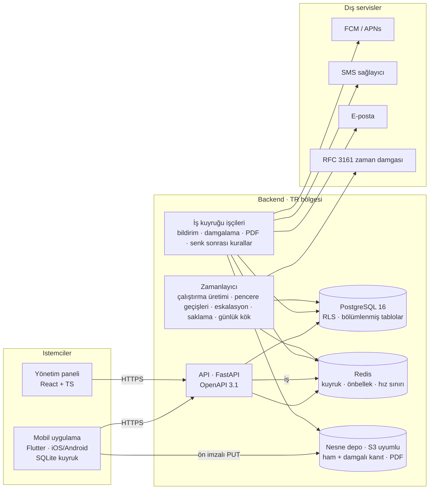

# Teknik mimari

Kararlar: ADR-0002 (Flutter / React / FastAPI / PostgreSQL), ADR-0003 (TR barındırma), ADR-0004 (kanıt bütünlüğü), ADR-0005 (RRULE + pencere). Bu belge bileşenleri, veri akışlarını, arka plan işlerini ve işletim gereksinimlerini tanımlar.

## Bileşen görünümü

## Katmanlar ve modüller (backend)

| Modül | Sorumluluk | Notlar |
|---|---|---|
| `auth` | OTP, şifre/TOTP, belirteçler, cihaz ve kiosk oturumları, hız sınırı | Belirteç: JWT (RS256), 15 dk; yenileme belirteci `user_session` tablosunda ve iptal edilebilir (web 12 sa / mobil 30 gün). Yenileme **döndürür**; tekrar kullanım zinciri düşürür. Depoda sırrın özeti durur |
| `org` | Hesap, bölge, şube, istasyon, takvim, kullanıcı, rol, grup, içe aktarma | RLS için `hesap_id` oturum değişkeni |
| `templates` | Şablon, sürüm, bölüm, madde, kural, yanıt/sebep setleri, kütüphane, doğrulama | Kural motoru saf fonksiyon (istemcide de aynı mantık — paylaşılan spesifikasyon testleri) |
| `scheduling` | Plan, RRULE değerlendirme, pencere hesabı, çalıştırma üretimi, durum makinesi | `dateutil.rrule` + şube saat dilimi; durum geçişleri tek fonksiyonda (tablo güdümlü testler) |
| `runs` | Çalıştırma, atama, cevap, ek kayıt, gönderim, puan | Puanlama saf fonksiyon |
| `evidence` | Ön imzalı yükleme, hash doğrulama, damgalama işi, imzalı indirme | Damgalama: Pillow ile metin bindirme; ham ve damgalı ayrı anahtar |
| `sync` | Delta manifest, toplu senk, zaman düzeltmesi, çakışma | Idempotency anahtarı: istemci UUID |
| `actions` | Sorun, aksiyon, yorum, geçişler, otomatik oluşturma, eskalasyon adımları | Eskalasyon adımları zamanlayıcı tablosunda (ESKALASYON_ADIMI) |
| `notify` | Kanal-bağımsız bildirim servisi, tercihler, sessiz saatler, teslimat izi | Kanal sürücüleri: push, sms, eposta (whatsapp v1.x) |
| `announce` | Duyuru, onay, hatırlatma | |
| `reports` | Izgara, raporlar, galeri, kişi takibi, dışa aktarımlar | Ağır sorgular için materialized view (gece) + gün içi canlı sorgular |
| `audit` | Olay günlüğü yazımı (tek giriş noktası), hash zinciri, günlük kök, doğrulama, denetim izi okuma | Yazım: DB tetikleyicisi değil, uygulama katmanı `audit.emit()`; tablo ekle-yalnız (DB rolü UPDATE/DELETE yetkisiz) |
| `privacy` | Aydınlatma sürümleri, KVKK talepleri, saklama silme işi | |
| `billing` | Aktif şube sayacı | Manuel faturalama |

## Mobil mimari (Flutter)

- Katmanlar: UI (widget) → durum yönetimi (Riverpod) → depo (repository) → yerel veritabanı (Drift/SQLite) + API istemcisi (OpenAPI'den üretilmiş).
- Çevrimdışı öncelik: tüm okuma yerelden; yazma yerel kuyruğa; `SyncService` arka planda (WorkManager / BGTaskScheduler) senkler; bağlantı gözlemi.
- Kural motoru: şablon kuralları JSON; Dart'ta değerlendirici, backend ile aynı spesifikasyon test setini (JSON fikstürleri) geçer.
- Kamera: uygulama içi kamera (camera paketi); galeri yalnızca şablon izin verirse; sıkıştırma (flutter_image_compress).
- Kiosk: cihaz belirteci + kullanıcı geçişi; hareketsizlik zamanlayıcısı; PIN yerel doğrulama yok — sunucu doğrular (çevrimdışıysa son 24 saatte doğrulanmış PIN hash'i önbellekten, süreli).
- Güvenlik: yerel veritabanı şifreli (SQLCipher); belirteçler güvenli depoda; sertifika sabitleme v2.

## Web mimari (React)

- Vite + TypeScript; durum: TanStack Query (sunucu verisi) + hafif yerel durum; form: react-hook-form; tablo/ızgara: TanStack Table; grafik: hafif SVG bileşenleri (dataviz kurallarına uygun); şablon editörü: dnd-kit.
- Yetki: menü ve eylemler belirteçteki rol/kapsama göre gizlenir; asıl denetim sunucuda.
- i18n hazır (tek dil TR); tarih/saat şube diliminde (Luxon).

## Arka plan işleri ve zamanlayıcı

| İş | Tetik | Sıklık | Notlar |
|---|---|---|---|
| Çalıştırma üretimi | Zamanlayıcı | Saat başı | 7 gün ileri; benzersiz anahtar; kapalı gün |
| Pencere geçişleri | Zamanlayıcı | Dakikada bir | Planlandı→Açık, bitiş uyarısı, tolerans→Kaçırıldı; bildirimleri kuyruğa |
| Eskalasyon adımları | Zamanlayıcı | Dakikada bir | ESKALASYON_ADIMI tablosundan vadesi gelenler |
| Bildirim gönderimi | Kuyruk | Anlık | Kanal sürücüsü; teslimat izi; yeniden deneme (3, üstel) |
| Kanıt damgalama | Kuyruk | Yükleme tamamlanınca | Hash doğrulama, damga, küçük resim |
| PDF/Excel üretimi | Kuyruk | İstek | Büyük işler arka planda; bildirim |
| Senk sonrası kural işleme | Kuyruk | Toplu senk sonrası | Koşullu mantık eylemleri (aksiyon, bildirim) idempotent |
| Günlük kök + TSA | Zamanlayıcı | 04:00 | Hash zinciri kökü; RFC 3161 |
| Saklama silme | Zamanlayıcı | Günlük 03:00 | Süresi dolan kanıt dosyaları; rapor |
| Materialized view yenileme | Zamanlayıcı | Gece | Raporlar |

Zamanlayıcı tek örnek (leader election Redis kilidi); işçiler yatay ölçeklenir.

**Ayakta mı, nasıl anlaşılır.** Zamanlayıcı bir HTTP sunucusu değil, "port
açık mı" diye sorulamaz. Döngü her **başarılı** turdan sonra bir nabız
dosyasına zaman damgası yazıyor; kabın sağlık kontrolü o dosyanın
tazeliğine bakıyor
(`python -m talimatname.scheduler --nabiz-denetle <yol>`). Başarısız tur
nabız atmadığı için üst üste hata veren ya da takılmış bir döngü de
sağlıksız görünüyor — yalnızca ölmüş süreç değil.

Bunu yazmanın sebebi gerçek bir olay: zamanlayıcı API ile aynı imajı
farklı bir komutla koştuğu için imajın `curl :8000` sağlık kontrolünü
miras almıştı ve **beş gün** kırmızı göründü, oysa turlar dönüyordu
(14.454 ardışık başarısızlık). Hep kırmızı bir bayrak, bayrak değildir.
Bu imajı farklı bir komutla koşan her servis kendi kontrolünü yazar.

## Veri akışı: kanıt yükleme

1. Mobil `POST /evidence/upload-url` → ön imzalı PUT URL (15 dk) + kanıt id.
2. Mobil dosyayı nesne depoya PUT eder (yeniden denenebilir, parça yükleme gerekmez ≤ 3 MB).
3. Mobil `POST /evidence/{id}/complete` (sha256, boyut, cihaz zamanı, konum) → API hash'i nesne meta verisiyle doğrular, KANIT kaydı, damgalama işini kuyruğa atar, olay günlüğü.
4. İşçi damgalı kopyayı ve küçük resmi üretir; KANIT güncellenir (yalnızca türetilmiş alanlar).
5. Okuma: `GET /evidence/{id}` → 15 dk imzalı URL (yetki kontrolü sonrası).

## Ortamlar ve dağıtım

- Konteyner (Docker); dağıtım: yönetilen Kubernetes veya docker-compose tabanlı VM'ler (başlangıçta 2 VM: api+worker, db+redis; nesne depo sağlayıcı servisi). Ölçek: API ve işçi yatay.
- Ortamlar: dev, test (CI), staging, prod (06-test/03). Yapılandırma ortam değişkenleriyle; gizli anahtarlar kasada.
- Şema göçleri: Alembic; geriye uyumlu (önce ekle, sonra kullan, sonra kaldır); mobil eski sürüm 2 sürüm geri desteklenir (API sürüm alanı).
- Sürüm: backend sürekli; mobil 2 haftada bir (mağaza inceleme süresi hesaba katılır); zorunlu güncelleme bayrağı (kritik hata için).

## Gözlemlenebilirlik

- Yapılandırılmış log (JSON) + istek kimliği; merkezi log (Loki/ELK); metrikler (Prometheus): API gecikme/hata, kuyruk derinliği, zamanlayıcı gecikmesi, bildirim teslim oranı, senk hata oranı; izleme (OpenTelemetry) kritik yollarda.
- Mobil: hata raporlama (Sentry) + senk günlüğü (son 7 gün, destek için dışa aktarılabilir).
- Uyarılar: zamanlayıcı 5 dk gecikirse; kuyruk > 10 dk; bildirim hata oranı > %5; API 5xx > %1; disk/depolama eşikleri.

## Kapasite (ilk 2 yıl, NFR-04)

2.000 şube × 5 liste × 20 madde ≈ 200.000 cevap/gün; 100.000 kanıt/gün × 350 KB ≈ 35 GB/gün ham + damgalı → ~1 TB/ay; PostgreSQL cevap tablosu ~70 M satır/yıl (aylık bölümleme); API tepe 200 istek/sn (kapanış saatleri 22:00–01:00 yığılması — ölçek testinde bu profil kullanılır).

## Açık teknik kararlar (Sprint 0)

1. Yönetilen Kubernetes mi, VM + compose mi (ekip büyüklüğüne göre; başlangıç VM).
2. Nesne depo sağlayıcısı (TR bölgesi, S3 uyumlu, sürümleme).
3. SMS sağlayıcısı (teslimat raporu API'si şart).
4. TSA sağlayıcısı (RFC 3161, TR'de yetkili ESHS tercih).
5. Damgalama için görüntü işleme kütüphanesi ve yazı tipi lisansı.
